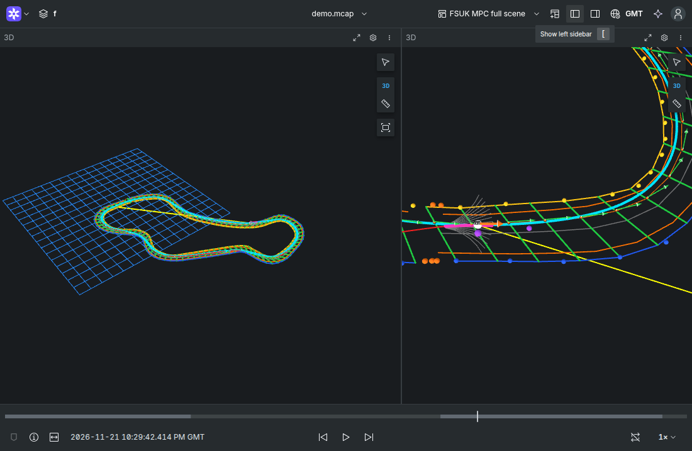

# Shalev Driving Lab

One interactive world for the Bristol FSAI car: **manual driving versus PID,
MPC, F1 imitation and FlyWire**, with the real core-sim2 actuator request,
third-person driving, real FSUK geometry and the maths/comparison explanation
on the same page.

**Live:** https://altcar.github.io/mpc-race-studio/


## One page, three layers

1. **Drive** — Three.js world at real metre scale, third-person chase camera,
   WASD manual, PID-PP, Stanley, MPC, F1 and FlyWire. Real track, kerbs,
   cones, start gantry, hills, trees, coastline and sky.
2. **Actuator** — actual speed mode RPM, torque Nm, mechanical brake %,
   steering degrees and slew. Motion follows the actuator-derived acceleration.
3. **Explain** — the live tentacle cost function, soft/hard corridor, bicycle
   model and the F1/FlyWire/MPC comparison with caveats.

## Third-person driving

The car is 1.9 m long, the road is the real FSUK width and the chase camera sits
5.6 m behind it, so the scene reads at driving scale. W/S throttle and brake,
A/D steer; the front wheels and the car body follow the real steering angle and
speed. The camera widens its field of view with speed.

## Competitions

- **Sprint** — fastest lap, balanced tracking.
- **Track drive** — 11 laps, consistency, higher comfort/soft weights.
- **Skidpad** — figure of eight, lateral/steering stability.
- **Acceleration** — peak speed, straight line, full brake into the orange box.

## Cone contact

Cones are collision-only objects. A cone inside the hit radius turns red and
increments the round's **CONES HIT** counter. At the end of a round only the
counter and the cone states reset — **the car keeps its position, speed and
heading**, so a lap is continuous. This is a planning/validation counter, not
rigid-body physics.

## Foxglove full-scene layout



The old saved layout had every 3D-panel topic **unchecked**, which is why the
panel only ever showed its grid. The fixed layout binds the scene explicitly:

| Panel | Frame | What it shows |
|---|---|---|
| Track overview | `track` | cones, gates, race line, soft/hard corridor, LeastAction vectors, car trail |
| Car chase | `car` | the whole world moves around the car: all MPC tentacles (grey), the selected tentacle (magenta), trail and constraints |

Open it with the recorded file:

https://app.foxglove.dev/97502a0a/p/prj_0egrq4fVsBIYJsHs/view?layoutId=lay_0ekIWYJEWi5J1OtK&ds=remote-file&ds.url=https%3A%2F%2Fcdn.jsdelivr.net%2Fgh%2Faltcar%2Fmpc-race-studio%40f889be4%2Fdemo.mcap

To import the layout into another account, use `foxglove_layout.json`
(Foxglove → layout menu → **Import from file…**).

`demo.mcap` is recorded by `planning_control/shalevtest/record_mcap.py` with a
real 37 s timeline and a `world → track → car` TF tree.

## Run locally

```bash
python3 -m http.server 8099
# http://localhost:8099
```

Static assets only: no Worker runtime. GitHub Pages rebuilds on every push.

## Source

- `planning_control/` — C++ planner, PID/MPC, core-sim2 actuator mapping
- `planning_control/shalevtest/` — GUI, Foxglove, validation, browser lab
- F1 and FlyWire models exported into `f1_model.json` / `fly_model.json`
- real FSUK geometry in `track_full.json`, `acceleration.json`, `skidpad.json`
