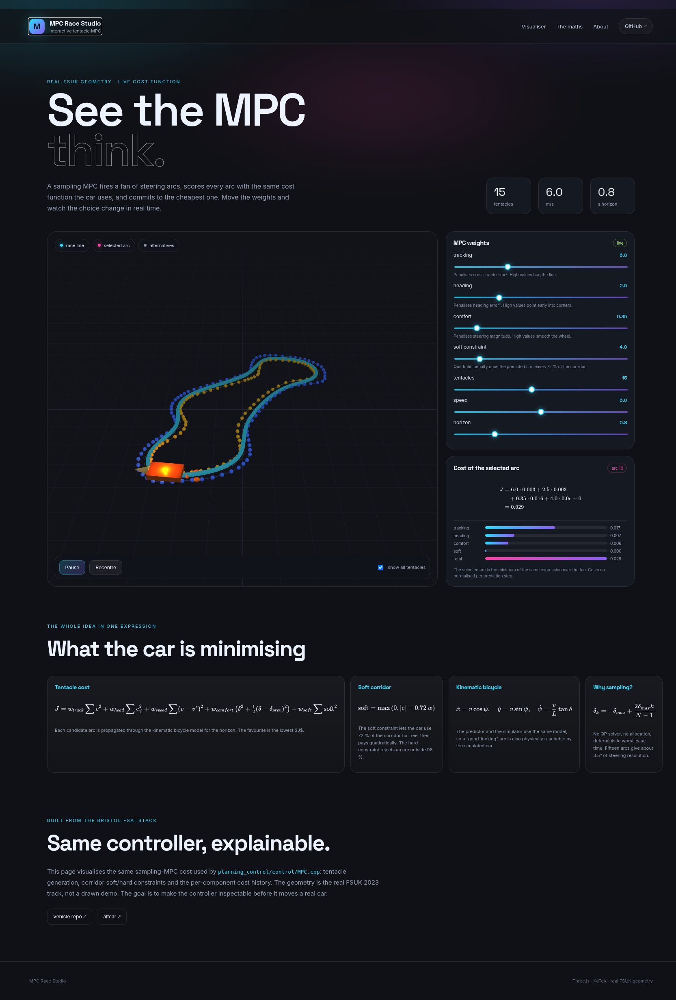

# MPC Race Studio

Interactive, explainable tentacle-MPC visualiser for the Bristol FSAI race car.

**Live:** https://altcar.github.io/mpc-race-studio/



The scene uses the real **FSUK 2023** race-line geometry, not a drawn demo. A
car follows the line while a fan of steering arcs is generated from the same
kinematic bicycle model used by the C++ MPC. Every arc is scored by the cost
function; the cheapest arc is highlighted in magenta and the equation updates
with the current weights.

## What is interactive

- tracking, heading, comfort and soft-constraint weights
- number of tentacles
- speed and prediction horizon
- show/hide alternative arcs
- pause / recentre the 3D camera
- the selected arc's cost expression and component bars update live

## The cost

$$
J=w_{track}\sum e^2+w_{head}\sum e_\psi^2
+w_{speed}\sum(v-v^*)^2
+w_{comfort}\left(\delta^2+\tfrac12(\delta-\delta_{prev})^2\right)
+w_{soft}\sum\mathrm{soft}^2
$$

$$
\mathrm{soft}=\max(0,|e|-0.72w)
$$

$$
\dot x=v\cos\psi,\qquad \dot y=v\sin\psi,\qquad
\dot\psi=\frac{v}{L}\tan\delta
$$

The page is a static Three.js + KaTeX site; no build step.

## Run locally

```bash
python3 -m http.server 8099
# open http://localhost:8099
```

## Source

- vehicle stack: `Formula-Student-AI/bristol-fsai-autonomous-driving-system`
- MPC reference: `planning_control/control/MPC.cpp`
- geometry: real `sim/src/map_lib/maps/competitions/FSUK/2023/trackdrive.csv`

## Design

Dark glass panels, cyan/magenta accents, Space Grotesk + Inter. The 3D view is
an OrbitControls scene; the equations use KaTeX. The page is responsive down
to a phone-width single column.
