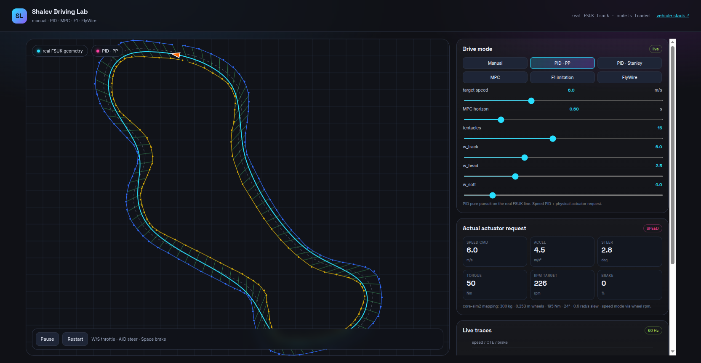

# Shalev Driving Lab — browser driving modes

A single-page browser lab for the same car: manual driving versus all the
planner/controller modes, with the **actual actuator request** shown and used.

Open `index.html` through a local web server (the JSON fetches need HTTP, not
`file://`).

## Modes

| Mode | What runs |
|---|---|
| Manual | W throttle, S/space brake, A/D steer. Torque/brake actuator path. |
| PID · PP | speed PID + pure pursuit on the real FSUK line |
| PID · Stanley | speed PID + Stanley heading/cross-track law |
| MPC | sampling tentacles, tracking/heading/comfort/soft cost |
| F1 imitation | exported F1 MLP throttle/brake + PP steering stabiliser |
| FlyWire | exported Kenyon/CX readout + PP stabiliser |

## Actual actuator values

The right panel is not a fake throttle percentage. It shows the core-sim2
mapping:

$$
rpm_{target}=\min\left(4000,\frac{60v_{cmd}}{2\pi(0.253)}\right)
$$

$$
\tau=\frac{300\cdot0.253\cdot|a+0.5|}{2}
$$

$$
b=\frac{-a}{10}\cdot100
$$

plus 24° steering, 0.6 rad/s slew and the speed-mode 50 Nm torque headroom.
The vehicle motion uses the actuator-derived acceleration, not a disconnected
animation.

## Models

- `f1_model.json` — exported behaviour-cloning weights/metrics from the real
  OpenF1 Silverstone data.
- `fly_model.json` — exported FlyWire-inspired Kenyon/CX readout.
- `track.json` — real FSUK 2023 race line, boundaries, gates and cones.

## Source

Everything here is a view over `planning_control/` and the two isolated
research folders. It does not change the car unless `/cmd` is published.
